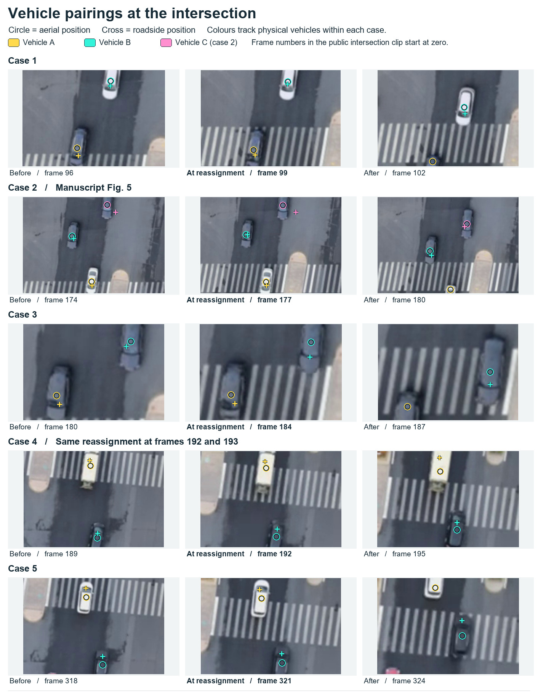

# Five vehicle-pairing cases at the study intersection

Increasing the matching distance from 5 to 10 m left the number of motor-vehicle matches at **5,401**. Yet ten pairs of aerial and roadside observation lists changed which vehicles were matched. This supplement shows all five vehicle configurations involved. Case 2 is the example in Fig. 5 of the paper.

## What changed

Both runs used the same observations, the same evaluation area and the same time offset (681 ms). At each paired time, the evaluator considered aerial objects in list order and selected the nearest unassigned roadside report across all classes. It accepted that report only if the classes agreed and the distance was strictly below the threshold. If either condition failed, the aerial object remained unmatched. Only reports inside the evaluation area were eligible. Each roadside report could be assigned once.

In all five cases, vehicle A was just inside the evaluation area while its own roadside report, **a**, was outside. We identified the corresponding vehicles using the overhead images and the roadside tracks before the area filter was applied. Across the ten list pairs, A lay 0.62–1.63 m from **a**. At 5 m, A went unmatched. At 10 m, A took report **b** from a different vehicle 7.07–9.55 m away. Another vehicle then lost its match. Case 2 shows a three-vehicle chain: A took B's report, B took C's report and C went unmatched.

| Case | Aerial frame(s) at reassignment | Pairs of observation lists | Vehicles affected |
| --- | --- | ---: | --- |
| 1 | 99 | 2 | A gained B's report; B lost its match. |
| 2 (Fig. 5) | 177 | 2 | A gained B's report; B switched to C's report; C lost its match. |
| 3 | 184 | 1 | The two trailing vehicles from case 2 appear again. The first took the second vehicle's report. |
| 4 | 192, 193 | 3 | At both frames, A gained B's report and B lost its match. One roadside list was paired with frame 192 and two with frame 193. |
| 5 | 321 | 2 | A gained B's report; B lost its match. |

Uppercase letters denote vehicles observed from the air; lowercase letters denote the roadside reports that tracked them in the review. Labels restart in each case. In case 3, A and B correspond to B and C in case 2. The ten list pairs span six distinct aerial times because two roadside lists can be paired with the same aerial list.

## Read the images

Each row shows three selected frames about 0.3 s apart. The centre column shows the first affected aerial frame for that configuration. A circle and a cross of the same colour identify the aerial and roadside positions attributed to one vehicle during review. They retain their measured separation. The colours follow the vehicles in the video across time, including a roadside report that fell outside the evaluation area. The table and CSV give the actual assignments at each threshold. Frame 180 appears in two rows because cases 2 and 3 overlap in time.

To replay the scenes, open the [public intersection clip](../../intersection_clip.webm). Frame numbering starts at zero in that clip. The [frame lookup](../../frame-lookup.csv) relates elapsed times in the aerial reference lists to estimated video frames. The images above are crops of this public viewing copy.

## Inspect the ten list pairs

[Download the comparison table (CSV)](list-pairs.csv). Each row describes one aerial list paired with one roadside list. Only the affected motor vehicles appear in the assignment columns. For example, `A=b` means that aerial vehicle A was assigned roadside report b. The two distance columns give the distance from the gaining vehicle to its own excluded report and to the report taken at 10 m, respectively. Distances are in metres.

`aerial_elapsed_s` is the elapsed time from the first aerial reference list. `aligned_road_minus_aerial_ms` is the roadside timestamp minus 681 ms minus the aerial timestamp; a negative value means the aligned roadside report was earlier. For a repeated video frame, this field distinguishes the two roadside lists. Across the ten comparisons, ten aerial observations gained a match, ten lost one and two kept a match with a different report.
